<h1 align="center">FPSCombatSystem</h1>
<p align="center">
  <b>Replicated, data-driven FPS combat framework with AI enemies and per-limb damage</b><br>
  Unreal Engine 5.5 · C++ · Gameplay Ability System · Client-predicted hit detection · Behavior Tree + EQS AI
</p>
<p align="center">
  
  
  
  
  
</p>

A multiplayer first-person shooter prototype where all combat logic runs through Unreal's Gameplay Ability System. Equipment grants weapons and abilities through data assets, shots are predicted on the client and validated on the server, damage flows through execution calculations (including per-limb multipliers read from tagged Physical Materials) into replicated attributes, and the HUD updates through gameplay messages. Enemies are AI-controlled players driven by a Behavior Tree, EQS and AI Perception, and they fight through the same abilities a human player uses. The project is profiled with Unreal Insights and `memreport`, and every fix is measured.

<h2>▶ Full demo: <a href="https://youtu.be/vLuyH66EC4M">Watch Here!</a></h2>

## Contents

- [Highlights](#highlights)
- [How a shot flows through the system](#how-a-shot-flows-through-the-system)
- [Features](#features): [Shooting](#shooting) · [Limb damage](#limb-damage) · [Grenades](#grenades) · [Movement and stamina](#movement-and-stamina) · [Items, equipment and quick bar](#items-equipment-and-quick-bar) · [Teams, spawning and respawn](#teams-spawning-and-respawn) · [Enemy AI](#enemy-ai) · [Death](#death)
- [Performance](#performance)
- [Project layout](#project-layout)
- [Getting started](#getting-started)

## Highlights

- **Predicted, validated shooting.** The owning client traces, the server validates before applying damage, and overlapping shots are matched by prediction key.
- **Per-limb damage from data.** Physical Materials carry gameplay tags (`Damage.Zone.Head/Torso/Arm/Leg`), each weapon maps zone tags to multipliers, and the server applies them inside the damage execution calculation.
- **AI that plays by the same rules.** Behavior Tree + EQS + AI Perception enemies are spawned as real players (PlayerState, ASC, quick bar) and fight by sending the same gameplay events a player's input would.
- **Data-driven combat.** Weapons, fire modes, recoil, grenades and ability sets are assets, not hard-coded.
- **Everything is a GAS ability.** Fire, aim, reload, throw, sprint, dash and updraft share one tag-driven rule set for blocking, cancelling and stamina cost.
- **Profiled, not guessed.** Animation cost, asset loading and texture memory were measured before and after each change.

## Features

### Shooting
<p align="center">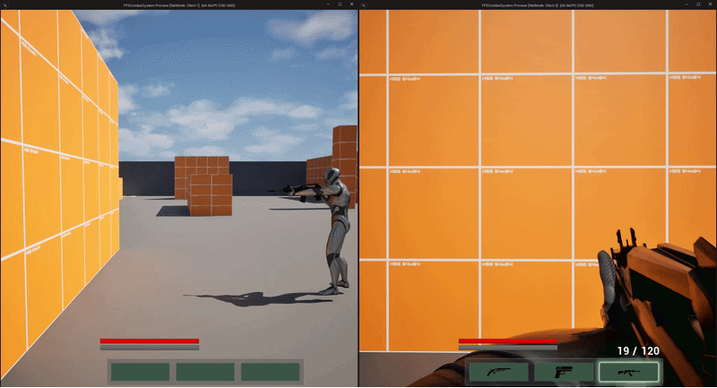</p>

- **One activation per shot.** Each shot gets its own prediction key and its own `CanFire()` check. Full-auto and burst run on a per-weapon timer that re-activates the ability. Fire modes are swappable objects chosen in the weapon definition.
- **Overlapping shots.** One ability instance serves all shots, so pending shots are tracked by prediction key. If the client cancels before sending data, it tells the server nothing is coming, so the server never waits on a dead key.
- **Recoil and spread.** Aimed and stationary shots follow a fixed recoil pattern. Hip-fire and moving shots use random spread in a disc with a tunable bias exponent.
- **Trust model.** The server rejects hits outside weapon range (plus a configurable slack) and re-traces from the shooter's view to check for a wall in between. It trusts the client about *which actor* was hit, so latency doesn't reject hits on moving targets. Lag compensation is the next step.

```cpp
const float MaxRange = FMath::Square(WeaponInstance->GetWeaponDefinition()->TraceRange + HitValidationRangeSlack);
if (FVector::DistSquared(ViewLoc, HitResult.Location) > MaxRange)
{
	return false;
}
```

- **Bots use the same path.** A bot's pawn is controlled on the server, so it runs the same targeting code there. It uses the pawn view location and the controller's control rotation instead of a player camera, and its hits go through the same validation and damage pipeline.

<p align="center">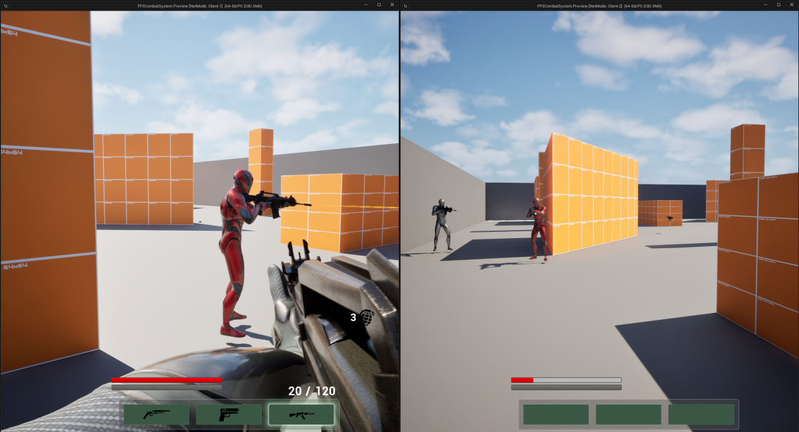</p>

### Limb damage
<p align="center">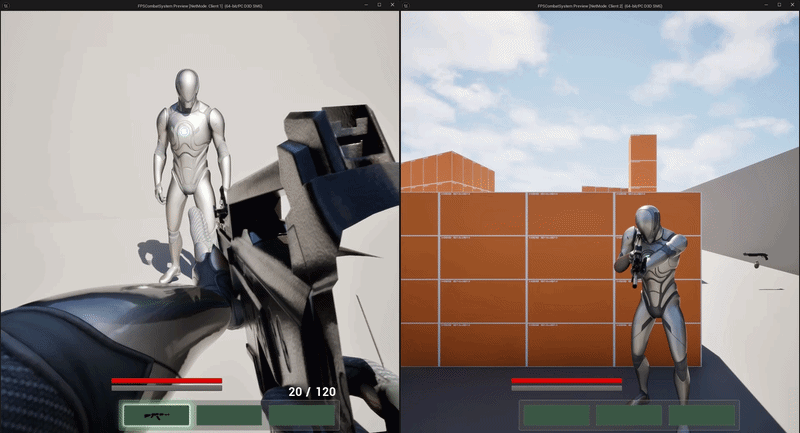</p>

Damage depends on which body part was hit, and there is no bone-name checking. Each body in the character's Physics Asset has a Physical Material, and that material carries gameplay tags.

- **Tagged Physical Materials.** `UPhysicMaterialWithTag` extends `UPhysicalMaterial` with a `FGameplayTagContainer`.

  ```cpp
  UCLASS()
  class FPSCOMBATSYSTEM_API UPhysicMaterialWithTag : public UPhysicalMaterial
  {
  	GENERATED_BODY()

  public:
  	UPROPERTY(EditAnywhere, BlueprintReadOnly, Category = "Physics")
  	FGameplayTagContainer Tags;
  };
  ```

  | Physical Material (`Content/FPSGame/Character/Physics/`) | Tag |
  |---|---|
  | `PM_Head` | `Damage.Zone.Head` |
  | `PM_Torso` | `Damage.Zone.Torso` |
  | `PM_Arm` | `Damage.Zone.Arm` |
  | `PM_Leg` | `Damage.Zone.Leg` |

- **The trace asks for the material.** The weapon trace sets `bReturnPhysicalMaterial = true`, so the hit result carries the material of the body that was struck.
- **Multipliers live in the weapon.** Every weapon definition has `TMap<FGameplayTag, float> ZoneMultipliers`, so a rifle and a shotgun can reward headshots differently without code changes.
- **Applied on the server, in the damage calculation.** `UFPSCombatDamageExecCalc` takes the captured base damage, adds the `SetByCaller` damage, then multiplies by the zone multiplier. All matching tags on a material are multiplied together, and a missing tag counts as ×1.

  ```cpp
  float CombinedMultiplier = 1.f;
  for (const FGameplayTag MaterialTag : PM->Tags)
  {
  	if (const float* TagMultiplier = WeaponInstance->GetWeaponDefinition()->ZoneMultipliers.Find(MaterialTag))
  	{
  		CombinedMultiplier *= *TagMultiplier;
  	}
  }
  return CombinedMultiplier;
  ```

  ```cpp
  BaseDamage += FMath::Max(Spec.GetSetByCallerMagnitude(FPSCombatGameplayTags::SetByCaller_Data_Damage, false, 0.f), 0.f);
  BaseDamage *= GetZoneMultiplier(ContextHandle);
  ```

- **Scope.** Zone multipliers apply only when the damage source is a ranged weapon instance. Explosion damage uses its own falloff and is not zone-scaled.
- **Surface-aware cues.** The hit's Physical Material is also passed into the gameplay cue parameters, so impact effects can vary per surface.
- **Directional hit reactions.** `GC_DamageDeal` (`GameplayCue.Damage`) selects and plays a directional hit-reaction montage on the victim (front, back, left, right).

### Grenades
<p align="center">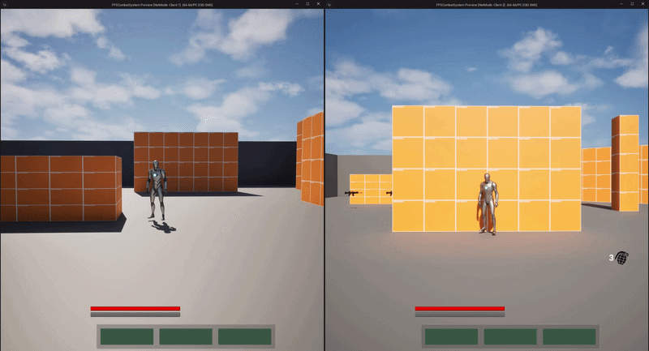</p>

- A throw ends in one of three ways: input release, an external resolve event, or a max-hold timer.
- Detonation is set per throwable: on first impact, after N bounces, or on a fuse timer.
- Damage uses a falloff curve over the blast radius. Detonation is server-only and one-shot, because impact, bounce and fuse can race.
- Charges are spent only after the projectile spawns. Throwable assets are preloaded asynchronously on equip.

### Movement and stamina
<p align="center">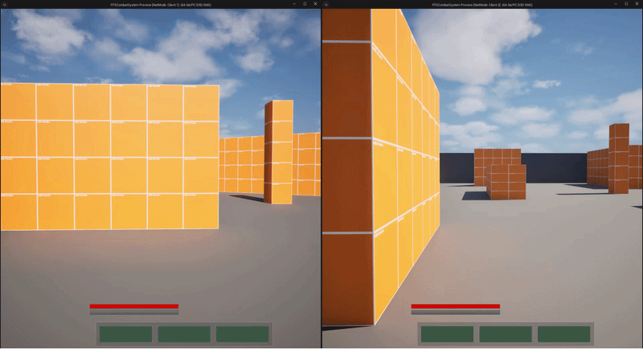</p>

- Walking, forward and airborne state are mirrored into gameplay tags. Move speed comes from a GAS attribute.
- Dash uses a root-motion source, and updraft launches the character.
- Running out of stamina cancels every ability tagged as requiring it.

### Items, equipment and quick bar
<p align="center">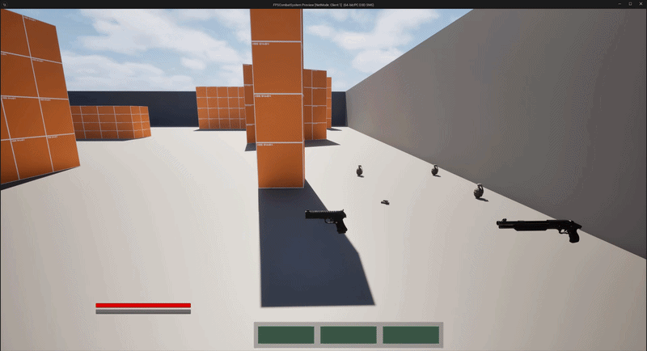</p>

- Items hold data and stacks. Equipping spawns the item's actors and grants its ability sets. The quick bar picks the active slot. All three replicate through fast arrays.
- HUD widgets and left-hand IK listen to gameplay messages and don't reference weapon code.
- The ASC lives on PlayerState, so the ability system survives respawn. The character binds it on possession and on `OnRep_PlayerState`.

### Teams, spawning and respawn

- **Teams.** `EFPSCombatTeam` has two values, `Player` and `Enemy`. The team comes from the pawn data asset and is set on the PlayerState (replicated), so players and bots report their team the same way through `IGenericTeamAgentInterface`. `UFPSCombatTeamLibrary::IsHostileTo` compares two agents' teams.
- **Pawn data per controller.** The GameMode returns `DefaultEnemyData` for enemy AI controllers and the player's pawn data otherwise. The PlayerState applies it: team, ability sets, pawn class.

  ```cpp
  if (DefaultEnemyData && InController->IsA<AFPSCombatEnemyController>())
  {
  	return DefaultEnemyData;
  }
  ```

- **Team-aware spawn points.** `AFPSCombatPlayerStart` has a team. `UFPSCombatSpawningManagerComponent` picks a random start of the controller's team, preferring starts that are not blocked by geometry for that pawn class, and falls back to blocked ones if none are free.
- **Respawn.** On death the GameMode starts one timer per controller (`RespawnDelay`), then unpossesses any leftover pawn and calls `RestartPlayer`. This works the same for players and bots.

### Enemy AI
<p align="center">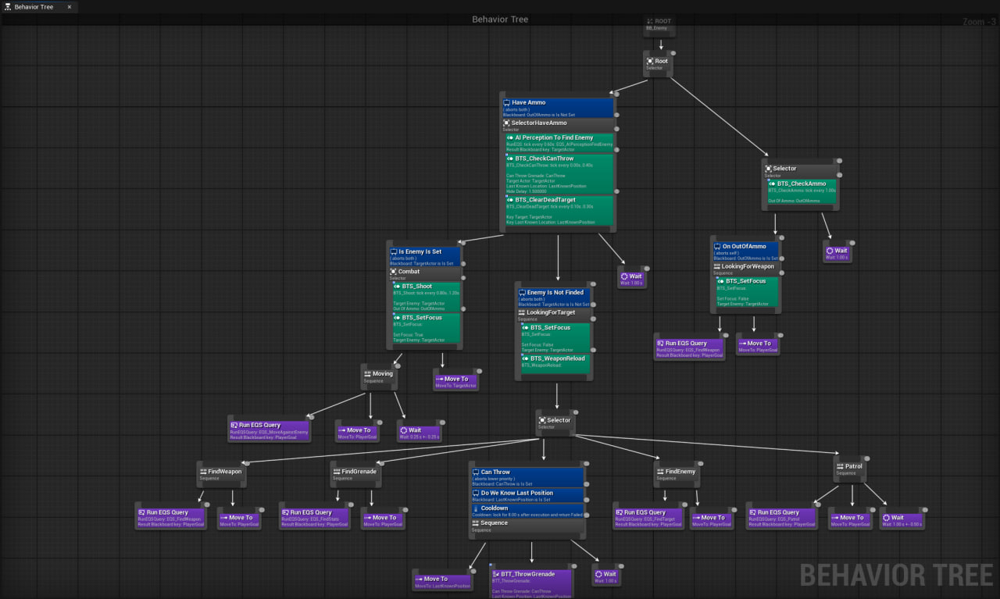</p>

Enemies are `AFPSCombatEnemyController` instances (`Source/FPSCombatSystem/AI/`). The design rule is that the AI never calls weapon code directly. It **sends gameplay events**, and the same GAS abilities a player triggers with input do the work. Anything that works for the player (recoil, ammo, stamina rules, damage zones) works for bots without extra code.

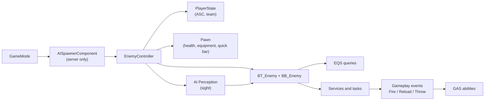

#### Spawning and identity

- `UFPSCombatAISpawnerComponent` runs on the server only. It spawns `DesiredBotsToCreate` bots (default 3) of `AIClass`.
- Each bot goes through the normal login flow, so it gets a PlayerState, an ASC, enemy pawn data (`DA_EnemyPawnData`) and an enemy ability set (`DA_EnemyAbilitySet`). AI-specific ability variants (`GA_AIReload`, `GA_AIThrow`) exist alongside the player ones.

  ```cpp
  AAIController* SpawnController = GetWorld()->SpawnActor<AAIController>(AIClass, FVector::ZeroVector, FRotator::ZeroRotator, SpawnParams);
  if (SpawnController != nullptr)
  {
  	AFPSCombatGameMode* GameMode = GetGameMode<AFPSCombatGameMode>();
  	GameMode->DispatchPostLogin(SpawnController);
  	GameMode->RestartPlayer(SpawnController);
  	SpawnedBotList.Add(SpawnController);
  }
  ```

#### Perception

Sight only, configured in the controller constructor. It detects enemies only, and the controller reports the team of its PlayerState, so bots never target their own team.

```cpp
Sight->SightRadius = 5000.f;
Sight->LoseSightRadius = 6000.f;
Sight->PeripheralVisionAngleDegrees = 80.f;
Sight->SetMaxAge(1.f);
Sight->DetectionByAffiliation.bDetectEnemies = true;
Sight->DetectionByAffiliation.bDetectFriendlies = false;
Sight->DetectionByAffiliation.bDetectNeutrals = false;
```

#### Behavior Tree and blackboard

On possess, the controller starts `BT_Enemy`, binds to the pawn's death event and refreshes perception. Decisions are made from `BB_Enemy` keys (`TargetActor`, `LastKnownPosition`, `OutOfAmmo`, `CanThrow`, `SelfActor`, `PlayerGoal`). Blackboard decorators abort lower-priority branches when keys change, and EQS queries write their results back into the blackboard.

| Asset (`Content/FPSGame/AI/Bot/`) | What it does |
|---|---|
| `BTS_SetFocus` | Keeps the bot's focus on its current target enemy |
| `BTS_Shoot` | Sends `GameplayEvent.Weapon.Fire` so the fire ability runs |
| `BTS_CheckAmmo` | Reads `Data.Weapon.Ammo.Mag` and `Data.Weapon.SpareAmmo` and updates `OutOfAmmo` |
| `BTS_WeaponReload` | Sends `GameplayEvent.AI.Reload`, which activates `GA_AIReload` |
| `BTS_CheckCanThrow` | Checks that the bot owns a throwable and updates `CanThrowGrenade` |
| `BTT_ThrowGrenade` | When the target is within throw range, sends `GameplayEvent.Projectile.Throw` (`GA_AIThrow`) |
| `BTS_ClearDeadTarget` | Clears the target key when the target's health component reports death |

**EQS queries** (`AI/Bot/EQS/`), with custom contexts for the target, weapon pickups and stat pickups:

| Query | Purpose |
|---|---|
| `EQS_AIPerceptionFindEnemy`, `EQS_FindTarget` | Choose which enemy to fight |
| `EQS_MoveAgainstEnemy` | Choose where to move relative to the enemy |
| `EQS_FindWeapon`, `EQS_FindStats` | Find weapon and stat pickups when the bot needs them |
| `EQS_Patrol` (with `BP_PatrolPoint`) | Choose patrol destinations |

#### Combat behaviors

**Shooting**
<p align="center">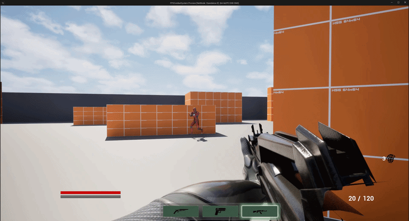</p>

**Resource handling: reload, then look for pickups.** The bot reloads through `GA_AIReload`. When ammo runs out, `OutOfAmmo` flips and the bot goes looking for a weapon or stat pickup through EQS.
<p align="center">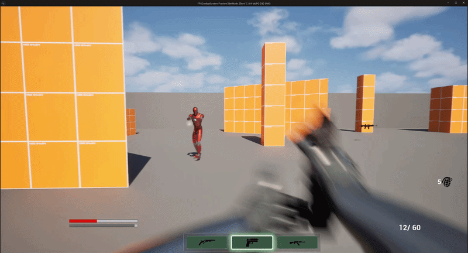</p>

**Grenades.** `BTS_CheckCanThrow` keeps `CanThrowGrenade` up to date, and `BTT_ThrowGrenade` throws only when the target is within range. The throw itself is the same grenade ability described above.
<p align="center">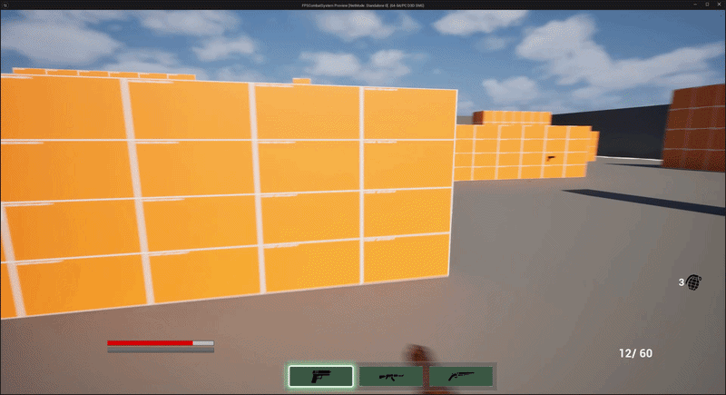</p>

### Death
<p align="center">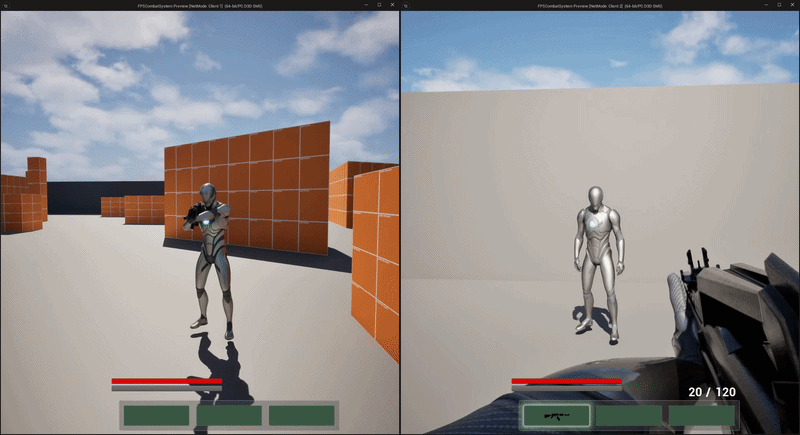</p>

- Death is a replicated state machine. `OnRep` handles skipped or out-of-order transitions, and a replicated `DeathInfo` makes the animation identical on every client.
- **For bots**, when the health component fires `OnDeathStarted` the controller stops its Behavior Tree, and the GameMode's respawn timer takes over.

  ```cpp
  void AFPSCombatEnemyController::OnDeathStarted(AActor* OwningActor)
  {
  	if (BrainComponent)
  	{
  		BrainComponent->StopLogic(TEXT("Pawn Dead"));
  	}
  }
  ```

<p align="center">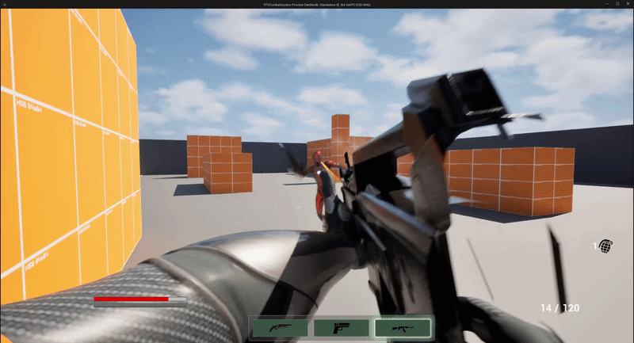</p>

## Performance

Every number below was measured with Unreal Insights or `memreport`. Where a number is an estimate, or a comparison isn't valid, the text says so.

| Change | Result |
|---|---|
| Animation update-rate optimization | **1.09 → 0.81 ms/frame (−26%)** |
| Async preload of throwable assets | 3.5 ms blocking load on first throw → **removed** (whole throw spawn 3.9 → 0.64–0.88 ms) |
| Grenade textures capped at 1024² (3 assets) | **42.8 → 2.8 MB (−93%)** |
| Cost of each extra character | **≈2.3 MB, linear**: ~2.1 MB GPU skin cache, ~0.18 MB UObjects |
| Own gameplay code, 17 characters | ~0.04 ms/frame (estimate, not optimized) |

The most useful result was a negative one: my own gameplay code is cheap, and the ability system component costs about 10 KB per character. The real costs were engine animation evaluation, one blocking load and oversized textures, so that is where the work went.

> **Scope of these numbers.** The benchmark characters are driven by a bare `AAIController` with scripted movement. They run no Behavior Tree, EQS or perception, so the figures below cover animation, ability-system and memory cost per character, not AI decision cost.

### Method

- **Tools:** Unreal Insights (CPU trace), `stat unit`, `memreport -full`.
- **Where:** editor, Play In Editor (New Editor Window), standalone net mode. These are editor-build numbers, not packaged-build numbers.
- **Scenario:** `FPSCombat.StressChars 16` spawns 16 AI-controlled characters, each with its own PlayerState and ASC, plus the local player (17 total). They stand on a ring around the player at 15, 30, 45 and 60 m, run with deterministic headings and jump every ~2 s. Same spot and facing for every capture.
- **Trace windows:** a flat stretch of about 9 to 10 s, away from spawn and GC spikes. Per-frame cost is the `Incl` time divided by the frame count (`FEngineLoop::Tick` count).
- **Memory:** `obj gc`, then `memreport -full`. Per-asset sizes come from the `ListTextures` section.
- **Instrumentation:** CPU trace scopes `FPSCombat_AnimUpdate`, `FPSCombat_GroundTrace`, `FPSCombat_LeftHandIK`, `FPSCombat_GrenadeSpawn` and `FPSCombat_Explosion` (compiled out of Shipping), plus a `Grenade released` trace bookmark on the throw.

### 1. Animation cost

With 17 characters, engine animation work dominated. My own scopes (`NativeUpdateAnimation`, ground trace, left-hand IK) cost about 0.04 ms per frame in total. The game thread spent most of its animation time waiting on parallel graph evaluation: `CompleteParallelAnimationEvaluation` was 93% `Excl` time.

**Change:** enabled animation update-rate optimization on the character mesh (`bEnableUpdateRateOptimizations = true`), so distant and off-screen characters update less often. About half of the benchmark ring is behind or far from the camera, which is where this applies.

| | Before | After |
|---|---|---|
| Frames in window | 746 | 677 |
| `TickAnimation` calls per frame | 17.0 | 8.3 |
| `TickAnimation` per frame | 0.55 ms | 0.34 ms (−39%) |
| `CompleteParallelAnimationEvaluation` per frame | 0.54 ms | 0.47 ms (−12%) |
| **Both together** | **1.09 ms** | **0.81 ms (−26%)** |

| Before | After |
|---|---|
| 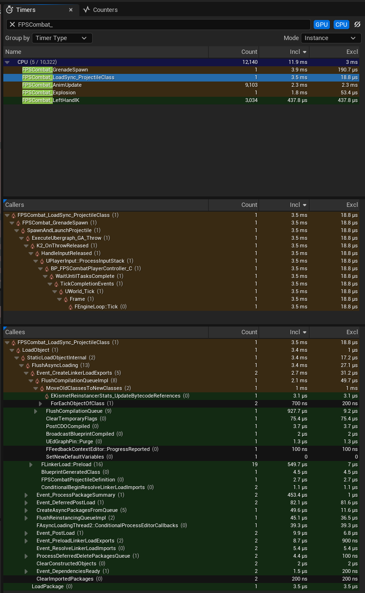 | 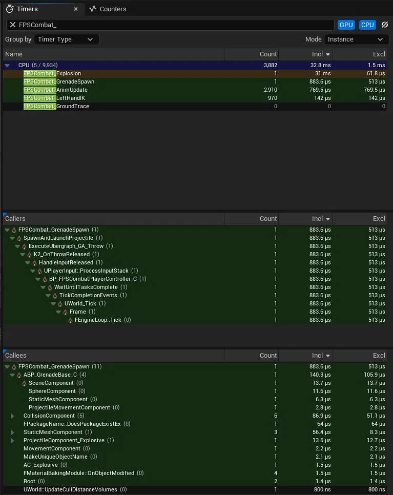 |

**Caveats**
- `stat unit` Game did not show a clear change (8.90 ms before, 9.17 ms after). The two readings came from different camera views, and a 0.28 ms saving is below that noise. The Insights numbers are the evidence.
- Distant characters get slightly stale poses. There is no lag compensation yet, so this matters for hit detection against skeletal hitboxes at long range. This also applies to per-limb hits: a Physical Material hit is only as accurate as the pose the physics bodies are in.
- One run per version.

### 2. First-throw hitch

The first grenade throw blocked the game thread on a synchronous load of the projectile class. `FPSCombat_LoadSync_ProjectileClass` took **3.5 ms** of the 3.9 ms `FPSCombat_GrenadeSpawn`, with `LoadObject` → `StaticLoadObjectInternal` → `FlushAsyncLoading` in the call tree. About 2.1 ms of that was `FlushCompilationQueueImpl`, which is editor-only Blueprint recompile work. The rest (about 1.3 ms) is regular package loading, so a packaged build would be lower.

**Change:** `UFPSCombatThrowableInstance::OnEquipped` collects the throwable's soft asset paths (projectile class and action montages) and starts an async load through the streamable manager. The loaded assets are cached on the instance and cleared in `OnUnequipped`. The throw ability reads only from the cache, so nothing blocks on the throw path. If the preload has not finished when the throw releases, the throw is skipped instead of loading synchronously.

**Result** (cold run: first PIE session after an editor restart, one throw):

| | Before | After |
|---|---|---|
| Blocking load (`FPSCombat_LoadSync_ProjectileClass`) | 3.5 ms | not in the trace |
| Whole throw spawn (`FPSCombat_GrenadeSpawn`) | 3.9 ms | 0.88 ms (0.64 ms in a second run) |

There is no `FlushAsyncLoading` under `FPSCombat_GrenadeSpawn` after the change.

| Before | After |
|---|---|
| 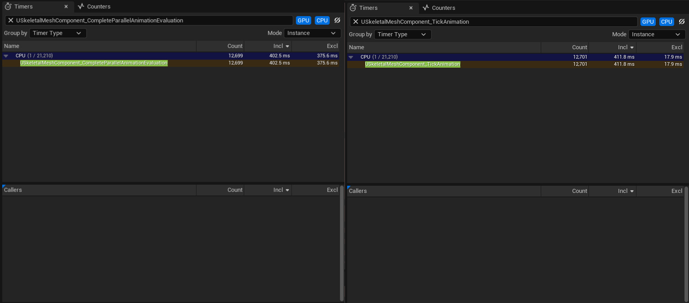 |  |

Single cold run per version, measured in PIE.

### 3. Memory

**Textures.** Per-asset sizes from `ListTextures`, with Maximum Texture Size set to 1024:

| Asset group | Before | After | Saved |
|---|---|---|---|
| 3 `T_pineapple_grenade*` textures (4096², when resident) | 42.8 MB | 2.8 MB | −40.0 MB (−93%) |
| 14 `T_Manny_*` textures | n/a | 13.8 MB (1024²) | n/a |

The three grenade textures were 21.4 + 10.7 + 10.7 MB at 4096² and are 1.4 + 0.7 + 0.7 MB at 1024². The caps are visually fine at gameplay distances in my check, but they are lower resolution than the source textures.

**Do not compare total texture memory between sessions.** It moved between 175 and 223 MB across sessions with the same content. That is streaming residency, not a change in the project: which mips are resident depends on what was equipped, visible or played. About 57 MB of the total is engine and editor content. Only the per-asset rows are valid comparisons.

**Per-character cost.** Idle vs. 16 stress characters, after `obj gc`:

| | Idle | 16 characters | Per character |
|---|---|---|---|
| Actors | 38 | 102 | 4 |
| UObjects | 61,418 | 62,138 | ~45 |
| UObject memory | 185.5 MB | 188.4 MB | ~0.18 MB |
| GPU skin cache | 1.9 MB | 35.0 MB | ~2.1 MB |
| `FPSCombatAbilitySystemComponent` | 10 KB | 173 KB | ~10 KB |

A second session gave the same shape: ~45 objects, ~0.18 MB UObject memory and ~2.2 MB skin cache per character. Each character costs about 2.3 MB, almost all GPU skin cache, and scales linearly. Each also owns three anim instances (`AnimBP_Base` plus two item anim layers), which is why animation updates run three times per character per frame. `Process Physical Memory` was not used: two editor processes sat about 600 MB apart at idle with the same content.

## Project layout

```text
Source/FPSCombatSystem/
├── AbilitySystem/   abilities, attribute set, damage/heal calcs, tag relationships, ability sets
├── AI/              enemy controller (perception, Behavior Tree start/stop), AI spawner component
├── Characters/      character, movement, health and stamina components
├── Items/           item definitions, instances, replicated item manager
├── Equipment/       equipment manager, quick bar
├── Weapons/         ranged weapons, fire modes, recoil, throwables, projectiles, explosions
├── Physics/         tagged Physical Material (limb detection)
├── Animation/       anim instances, left-hand IK
├── Interaction/     world and weapon pickups
├── Teams/           team helpers (hostility checks)
├── Spawning/        team player starts, spawn manager component
├── UI/              HUD widgets
├── Input/           input config, player controller
├── GameModes/       game mode (pawn data, respawn), game state, player state
└── Debug/           stress-test console commands (non-Shipping)

Content/FPSGame/
├── AI/              BT_Enemy, BB_Enemy, EQS queries and contexts, services, tasks, enemy blueprints
├── AbilitySystem/   abilities (player + AI), ability sets, effects, gameplay cues
├── Character/       animation, pawn data, physical materials (PM_Head / Torso / Arm / Leg)
└── Gameplay/        weapons, grenades
```